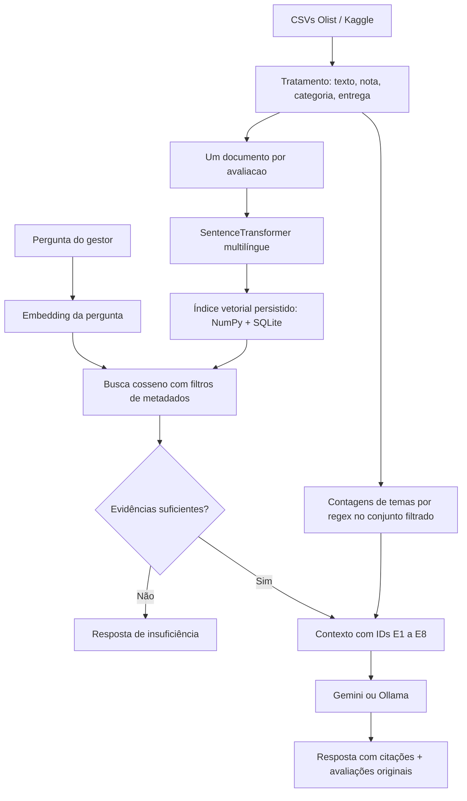

# Voice of Customer Intelligence com RAG — FIAP Pós-Tech, Fase 4

[](https://www.python.org/)
[](https://streamlit.io/)
[](https://www.kaggle.com/datasets/olistbr/brazilian-ecommerce)

## Resumo executivo

Aplicação de **Voice of Customer Intelligence (VoC)** para responder perguntas sobre avaliações reais de consumidores da Olist. Usa um pipeline **RAG (Retrieval-Augmented Generation)**: prepara avaliações, gera embeddings multilíngues, recupera textos por similaridade cosseno, filtra por metadados, monta contexto com fontes `[E1]`, `[E2]` e solicita uma resposta a um LLM com instruções explícitas de fundamentação.

O painel exibe o texto integral das avaliações usadas, sua nota, identificadores de origem e similaridade da busca. Perguntas sem suporte suficiente são recusadas. Um resumo exploratório separado contabiliza **menções por palavras-chave sobre todo o recorte filtrado**, sem confundir amostra de busca com estatística de frequência.

> **Status do pacote:** código-fonte, scripts, instruções, avaliação exploratória e testes prontos. Os resultados empíricos reais somente aparecem **após baixar a base, executar a indexação e configurar um LLM**. O dataset e as chaves não são distribuídos no repositório.

## Executar no Windows — automático

1. Instale **Python 3.11 ou 3.12** em <https://www.python.org/downloads/> e habilite **Add Python to PATH**, se não estiver instalado.
2. Descompacte o projeto em uma pasta.
3. Dê dois cliques em `INICIAR_WINDOWS.bat` (primeira execução instala dependências, baixa o Kaggle Olist e gera embeddings).
4. Quando o navegador abrir o painel, informe a **chave da API Gemini** na barra lateral. É possível obtê-la no [Google AI Studio](https://aistudio.google.com/app/apikey). Verifique disponibilidade, cotas, custos e condições aplicáveis.
5. Escolha uma pergunta e clique em **Buscar evidências e responder**.

**Verificação adicional das fontes:** se o LLM retornar texto sem citações válidas `[E1]`, `[E2]` etc., a aplicação faz uma única nova tentativa com formato de resposta mais restrito. Se ainda não houver citação válida, apresenta um modo de contingência **extrativo** com os próprios comentários identificados e, quando disponíveis, contagens heurísticas do recorte; não apresenta a saída rejeitada como se fosse fundamentada. O modo extrativo não substitui a demonstração da geração fundamentada por LLM no vídeo.

**Sem chave externa:** selecione `Ollama (local)` na barra lateral, instale [Ollama](https://ollama.com/) e, em outro terminal, execute `ollama pull qwen2.5:3b`. O Ollama deve estar rodando localmente. O aplicativo também permite **recuperar avaliações mesmo sem chave**, mas nesse caso não há resposta gerada pelo LLM.

Caso o download público automático falhe, baixe manualmente os CSVs em <https://www.kaggle.com/datasets/olistbr/brazilian-ecommerce/data> e extraia-os em `data/raw/` (sem pastas intermediárias); depois execute o arquivo `.bat` novamente.

### Linux e macOS

```bash
bash iniciar_linux_mac.sh
```

### Execução manual e teste rápido

```bash
python -m venv .venv
# Ative o ambiente criado (.venv/Scripts/activate no PowerShell; source .venv/bin/activate no Unix)
pip install -r requirements.txt
python scripts/build_index.py --limit 1000
python -m streamlit run app.py
```

**Importante:** o comando com `--limit` só é para teste; retire `--limit` e execute novamente para indexar a base completa. No Windows, se a execução automática criou índice parcial em teste anterior, exclua `artifacts/embeddings.npy`, `artifacts/documents.sqlite` e `artifacts/manifest.json` para forçar a reconstrução no `.bat`.

### Testes

```bash
python -m pytest -q
python scripts/evaluate.py
```

`pytest` cobre partes da preparação, persistência, recuperação, política de evidência e contexto do LLM. `evaluate.py` fornece **uma proxy por correspondência temática baseada em regex**: **não** é precisão anotada por humanos nem verificação de factualidade do LLM.

## Arquitetura



### Decisões técnicas

| Componente | Escolha | Motivo |
|---|---|---|
| Base | [Brazilian E-Commerce Public Dataset by Olist](https://www.kaggle.com/datasets/olistbr/brazilian-ecommerce) | Fonte indicada no enunciado da FIAP, dados históricos de compras e avaliações |
| Documento | **Uma avaliação escrita = um documento** | Unidade natural de evidência; comentários tipicamente curtos; evita separação de contexto |
| Limpeza | Nulos, espaços, tags HTML e duplicatas `(review_id, order_id)` | Evita indexar vazio e duplicidades sem adulterar opiniões |
| Metadados | Nota, data, categoria(s), atraso de entrega observado | Filtros; categorias agregadas por pedido antes do join para não inflar contagens |
| Embeddings | `paraphrase-multilingual-MiniLM-L12-v2` | Compatível com português; dimensão 384; execução local |
| Índice | Vetores L2 normalizados `float32` em `.npy` + dados em SQLite | Transparente, simples de reproduzir, escalável para dezenas de milhares de comentários |
| Recuperação | Similaridade cosseno, top-k ajustável e limite mínimo | Recuperação semântica com filtro por score/categoria/entrega |
| Geração | Gemini ou Ollama (LLM) | Permite API remota ou geração local |
| Evidência | `[E1]...` associados a `review_id` e `order_id` | Auditoria da resposta no painel |
| Pergunta sem suporte | Similaridade, relação textual e orientação explícita de abstenção | Reduz respostas especulativas; controle heurístico, não infalível |
| Frequência | Contagem por palavras-chave no **corpus filtrado** | Não extrapola frequências a partir de top-k; temas podem sobrepor |

## Perguntas sugeridas

- Quais são os principais problemas relatados pelos clientes?
- O que os consumidores reclamam sobre atrasos na entrega?
- Quais aspectos da compra são mais elogiados?
- Quais relatos mencionam defeitos ou baixa qualidade dos produtos?
- Quais experiências foram relatadas sobre atendimento?
- Que evidências sustentam a recorrência de menções a prazo de entrega?

## Reprodutibilidade

- **Requisitos**: Python 3.11/3.12, conexão para baixar dataset e embeddings na primeira execução; capacidade de memória suficiente para vetores (base Olist é de dezenas de milhares de avaliações com texto).
- **Fonte oficial da base**: <https://www.kaggle.com/datasets/olistbr/brazilian-ecommerce/data>.
- **Fontes externas**: download público via `kagglehub`; modelo de embeddings via Hugging Face; modelo gerativo configurado pelo usuário.
- **Sem segredos no Git**: `.env`, CSVs, índices e ambientes virtuais ignorados.
- **Escopo temporal**: conjunto histórico Olist 2016–2018; não descreve satisfação atual de qualquer empresa.
- **Limitações**: tokenização do modelo pode truncar textos excepcionalmente longos; similaridade não é probabilidade de verdade; filtros lexicais podem falhar por sinônimos; prompt de grounding não elimina alucinações; categoria(s) podem corresponder a vários itens de um pedido; `atrasou_entrega` usa datas entregue x prevista e não explica causas.

## Estrutura

```text
app.py                        Interface Streamlit
INICIAR_WINDOWS.bat           Inicialização guiada no Windows
iniciar_linux_mac.sh          Inicialização no Unix
scripts/build_index.py        Baixar dados, preparar corpus e indexar embeddings
scripts/evaluate.py           Avaliação exploratória de recuperação
src/voc_olist/data.py         ETL e rótulos transparentes
src/voc_olist/download.py     Download Kaggle
src/voc_olist/store.py        Vetores / metadados / manifest
src/voc_olist/retrieval.py    Top-k + threshold + filtros + sem evidência
src/voc_olist/metrics.py      Contagens do corpus
src/voc_olist/llm.py          Prompt fundamentado + Gemini/Ollama
src/voc_olist/pipeline.py     Orquestração RAG
 tests/                      Testes automatizados com dados sintéticos
 docs/                       Arquitetura, decisão, apresentação e execução
```

## Como apresentar a solução (entregáveis)

1. **GitHub público**: envie os arquivos deste pacote (não faça upload dos CSVs, índices ou `.env`). O README já contém as instruções e decisões exigidas.
2. **Vídeo de até sete minutos**: use [`docs/ROTEIRO_VIDEO.md`](docs/ROTEIRO_VIDEO.md), demonstrando consultas e abrindo suas fontes.
3. **Prova de execução**: execute os testes e `scripts/evaluate.py` e registre capturas reais dos resultados; não apresente como resultados observados números não obtidos na execução.
4. **Créditos**: Olist (dataset); FIAP Pós-Tech (enunciado); bibliotecas open source conforme seus respectivos projetos.

### Alinhamento ao enunciado da Fase 4

| Requisito solicitado | Arquivo/funcionalidade |
|---|---|
| Base de conhecimento: seleção, limpeza, nulos, embeddings, armazenamento | `data.py`, `store.py`, `build_index.py` |
| Pipeline pergunta → embedding → recuperação → contexto → geração | `retrieval.py`, `llm.py`, `pipeline.py` |
| Fundamentação com avaliações | citações `[E1]` etc. e IDs no `app.py` |
| Ausência de evidências | `search()` com limiar e recusa; instruções para LLM |
| Enriquecimento por nota, período, pedido, entrega, categoria | `data.py` e filtros no `app.py` |
| Código, instalação, decisões, exemplo, reprodução | este README, `docs/`, scripts e testes |
| Vídeo ≤7 minutos | `docs/ROTEIRO_VIDEO.md` |

## Atribuição

Base: *Brazilian E-Commerce Public Dataset by Olist*, publicada pela Olist no Kaggle, <https://www.kaggle.com/datasets/olistbr/brazilian-ecommerce>. Respeite os termos vigentes da plataforma/dataset. Dados-fonte não estão inclusos nem serão enviados ao GitHub por padrão.
